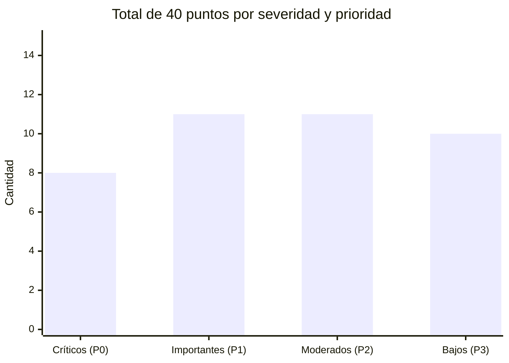

# Análisis de Mejoras — Coffee Hacienda POS

> [!NOTE]
> Análisis estático del código fuente y nuevos requerimientos operativos/UX.
> Incluye 30 hallazgos técnicos iniciales + 10 requerimientos funcionales y de negocio con su respectiva validación técnica.

---

## 🔴 Críticos — Acción inmediata

### 1. `apply_migrations.py` (líneas 110–121) — Bug funcional en migraciones
Las migraciones SQL se aplican pero **nunca se registra la versión en `tschema_migrations`**. Si el script se vuelve a ejecutar, todas las migraciones se repiten y pueden duplicar columnas o corromper datos.

**Fix:** insertar el registro de versión después de cada migración exitosa:
```sql
INSERT INTO tschema_migrations (version, nombre) VALUES (%s, %s)
```

---

### 2. `autenticacion_bp.py` línea 161 — Oracle de enumeración de correos
Al recuperar contraseña, cuando el correo **no existe** se muestra:
> *"El correo electrónico no está registrado en nuestro sistema."*

Esto confirma a un atacante qué cuentas existen.

**Fix:** mensaje genérico en **ambas** ramas + misma redirección.

---

### 3. `autenticacion_bp.py` líneas 95–97 — Cuenta desactivada revela existencia
El mensaje `"Esta cuenta está desactivada"` se muestra **antes** de verificar la contraseña, lo que confirma que el usuario existe.

**Fix:** verificar el hash primero, o usar un mensaje genérico de credenciales inválidas.

---

### 4. `autenticacion_bp.py` línea 131 — Timing side-channel en recuperación
Cuando el correo existe, la respuesta tarda más (genera código, envía email). La diferencia de tiempo puede confirmar existencia aunque el mensaje sea genérico.

**Fix:** operación dummy de duración similar cuando el correo no existe.

---

### 5. `modelsVentas.py` líneas 587–590 — Excepción relanzada inconsistentemente
`procesar_venta_completa` hace `raise` en su bloque `except`, mientras **todos** los demás modelos retornan `False`. En producción con `DEBUG=True` esto puede filtrar stack traces.

---

### 6. `ventas_bp.py` línea 148 — Sin límite superior en `por_pagina`
```python
por_pagina = request.args.get('por_pagina', 15, type=int)
```
Un atacante puede enviar `?por_pagina=1000000` y forzar queries masivos.

**Fix:**
```python
por_pagina = min(max(request.args.get('por_pagina', 15, type=int), 1), 100)
```

---

## 🟠 Importantes

### 7. Sin validación de formato de correo electrónico
`usuarios_bp.py` (líneas 59, 243) y `autenticacion_bp.py` (línea 126) no validan el formato `x@y.z` antes de procesar el correo.

**Fix:** agregar `validar_formato_correo()` en `utils.py`.

---

### 8. `modelsProductos.py` — `SELECT *` en múltiples consultas (líneas 41, 57, 69, 100, 216)
Si en el futuro se agrega una columna sensible a una tabla, se filtraría automáticamente hacia la API.

**Fix:** usar columnas explícitas en todos los `SELECT`.

---

### 9. `modelsProductos.py` línea 191 — Fuga de mensaje de error interno de BD
```python
return False, f"Error al actualizar producto: {e}"
```
Puede exponer nombres de tablas, columnas o mensajes internos de MySQL hacia el cliente.

---

### 10. `app.py` línea 105 — CSP permite `'unsafe-inline'` en scripts
```
script-src 'self' 'unsafe-inline'
```
Anula casi toda la protección XSS que ofrece la Content Security Policy.

**Fix:** usar nonces o hashes SHA256 por script inline.

---

### 11. `extensions.py` + `config.py` — Rate limiter en memoria en producción
Con `RATELIMIT_STORAGE_URI=memory://`, los contadores no persisten entre workers de Gunicorn/Waitress. Un atacante puede evadir el rate limit distribuyendo peticiones entre workers.

**Fix:** validar que Redis esté configurado cuando `APP_ENV=NUBE`.

---

### 12. `modelsHistorial.py` líneas 33–61 — SQL dinámico con f-strings
La cláusula WHERE se construye con concatenación + f-strings. Los parámetros actuales son seguros, pero el patrón es difícil de auditar y frágil ante futuras refactorizaciones.

---

### 13. Pruebas de integración no corren en CI
El workflow CI ejecuta solo `pytest -m "not integration"`, sin verificar los flujos reales de BD (ventas, cortes, migraciones).

**Fix:** job de CI con un MySQL service en GitHub Actions.

---

## 🟡 Moderados — Deuda técnica

| # | Archivo | Descripción |
|---|---------|-------------|
| 14 | `modelsUsuarios.py` (líneas 152/332) | Antipatrón: marcador `__CAMBIO_CORREO__` en columna `usuario` para distinguir tipo de validación. **Fix:** columna `tipo_validacion ENUM('alta', 'cambio_correo')`. |
| 15 | `modelsLimpieza.py` | Limpieza de registros expirados solo al arrancar. En producción los registros se acumulan indefinidamente. **Fix:** APScheduler o MySQL EVENT periódico. |
| 16 | `productos_bp.py` (líneas 112–116) | Imágenes huérfanas al actualizar: la imagen anterior no se elimina. **Fix:** `os.remove()` de la imagen previa. |
| 17 | `modelsVentas.py` (líneas 11–21) | `_detalle_tiene_variante_id()` consulta `information_schema.COLUMNS` en cada llamada a rutas críticas. **Fix:** cachear en variable de módulo. |
| 18 | `modelsInventario.py` (líneas 56–65) | Constantes mágicas `stock_minimo + 5` y `stock_minimo + 10` hardcodeadas en SQL. **Fix:** mover a `config.py`. |
| 19 | `bd.py` | `maxconnections=10` × N workers de Gunicorn = N×10 conexiones. Aiven limita a 10–25. **Fix:** documentar y validar al iniciar. |
| 20 | `pyproject.toml` línea 13 | Ruff con reglas mínimas (`E9, F63, F7, F82`). No detecta bugs ni seguridad. **Fix:** añadir `B` (Bugbear), `S` (seguridad) y `C90` (complejidad). |
| 21 | `services/auditoria.py` | La carpeta `services/` está excluida del `fail_under = 100`, sin cobertura verificada. |
| 22 | `modelsHistorial.py` (líneas 24–30) | `fecha_inicio` y `fecha_fin` pasan al SQL sin validar formato `YYYY-MM-DD`. MySQL puede ignorar filtros silenciosamente. |

---

## 🟢 Bajos / Calidad de código

| # | Archivo | Descripción |
|---|---------|-------------|
| 23 | `utils.py` línea 107 | Sin límite máximo de longitud de contraseña. Contraseñas >1000 chars son un ataque DoS a bcrypt. **Fix:** rechazar si `len(contrasena) > 128`. |
| 24 | `modelsProductos.py` (líneas 77–93, 129–141) | `agregar_variante_producto` y `eliminar_variantes_producto` no llaman a `conn.rollback()` en sus bloques `except`. |
| 25 | `modelsVentas.py` | `procesar_venta_completa` tiene >265 líneas. **Fix:** extraer subfunciones para mejorar legibilidad y testabilidad. |
| 26 | `config.py` | `SameSite=Lax` podría ser `Strict` en producción para mayor protección CSRF. |
| 27 | `finanzas_bp.py` línea 159 | Búsqueda de PDF por coincidencia parcial de fecha en nombre de archivo. Puede retornar el archivo incorrecto. **Fix:** buscar por ID de corte. |
| 28 | `requirements.txt` línea 9 | `redis` siempre instalado aunque sea opcional. Mover a `requirements-prod.txt`. |
| 29 | `modelsInventario.py` | `contar_alertas_inventario` se llama en cada request autenticado (context processor) pero no tiene pruebas de umbral. |
| 30 | `bd.py` línea 12 | `load_dotenv()` a nivel de módulo. En tests puede cargar un `bd.env` real, afectando la BD de producción desde el entorno de pruebas. |

---

## 📋 Requerimientos Recientes: Corte de Caja, UX, Operación y Validación

Solicitudes operativas y de experiencia de usuario recientes, junto con su análisis técnico, prioridad y precauciones arquitectónicas:

### 31. Corte de caja continuo obligatorio (Solo desde el último corte) — 🔴 P0 / Crítico Contable
* **Problema actual:** `fechaDesde` es un campo libre en `templates/corteCaja.html`. El usuario puede seleccionar fechas arbitrarias, provocando huecos sin auditar o solapamientos con cortes previos.
* **Solución técnica:**
  * **Backend:** Crear `obtener_fecha_ultimo_corte()` en `modelsCorteCaja.py`. En `/guardarCorteCaja` validar estrictamente que `fecha_inicio` coincida con la fecha de cierre del último corte registrado (o primera venta del sistema si no hay historial previo).
  * **Frontend:** Bloquear el campo `fechaDesde` como `readonly` precargado con la fecha del último corte. Establecer `fechaHasta` con la fecha y hora actual (`min = fechaDesde`).
* **Archivos involucrados:** `models/modelsCorteCaja.py`, `blueprints/finanzas_bp.py`, `templates/corteCaja.html`, `static/js/corteCaja.js`, `static/js/guardarCorteCaja.js`.

---

### 32. Ciclo de vida y expiración de pedidos pendientes — 🟠 P1 / Operativo
* **Problema actual:** Pedidos no cobrados o abandonados pueden permanecer indefinidamente como "Pendientes", reteniendo existencias de inventario o saturando el monitor de pedidos.
* **Solución técnica:** Establecer una política de expiración o alerta visual por inactividad (ej. 30–60 minutos). Implementar botón de cancelación masiva/individual por inactividad con liberación automática de stock.
* **Archivos involucrados:** `blueprints/ventas_bp.py`, `models/modelsVentas.py`, `templates/ventas.html`.

---

### 33. Modales de confirmación con motivo para acciones críticas — 🟠 P1 / Seguridad y Auditoría
* **Problema actual:** Modificaciones de inventario (`Ajustar stock`, `max`, `min`) y cancelaciones pueden ejecutarse por error o sin dejar constancia del porqué.
* **Solución técnica:** Modal estandarizado de confirmación que solicite obligatoriamente un "Motivo". Este motivo se envía al backend y se almacena en la tabla `tauditoria` (campo `detalles`).
* **Archivos involucrados:** `templates/inventario.html`, `templates/ventas.html`, `blueprints/inventario_bp.py`, `services/auditoria.py`.

---

### 34. Normalización de mesas y tipo de servicio ("Para llevar" vs "Sin mesa") — 🟡 P2 / UX y Datos
* **Problema actual:** En el registro de ventas se muestra `"Sin mesa"` o texto libre `"Mesa: 42"`, lo que causa inconsistencias en tickets y reportes.
* **Solución técnica:**
  * Reemplazar el campo de texto libre por un selector cerrado:
    1. Opción por defecto: `"Para llevar"`.
    2. Opciones de comedor: `"Mesa 1"` a `"Mesa 5"` o `"Barra"`.
  * Normalizar la columna `mesa` en `tventas` para que almacene valores estándar.
* **Archivos involucrados:** `templates/ventas.html`, `blueprints/ventas_bp.py`, `models/modelsVentas.py`.

---

### 35. 🚨 REGLA ESTRICTA: Prohibición de borrado del historial de ventas — 🔴 P0 / Integridad y Legal
* **Consulta planteada:** *"¿El historial de ventas se debería borrar cada semana?"*
* **Dictamen:** **PROHIBIDO.**
* **Riesgos evitados:**
  1. **Legal y fiscal:** Incumplimiento de normativas de retención de registros de comercio y comprobantes.
  2. **Destrucción de métricas:** Pérdida irreversible de reportes financieros mensuales/anuales, márgenes de ganancia y trazabilidad de cajeros.
  3. **Devoluciones:** Imposibilidad de atender reclamos o garantías de tickets pasados.
* **Solución técnica:** La base de datos conserva permanentemente las ventas. En el frontend se implementa un filtro por defecto de "Ventas de hoy" o "Esta semana" con paginación server-side.

---

### 36. Almacenamiento seguro de tickets y exportación dinámica a Excel — 🟠 P1 / Arquitectura
* **Problema identificado:** Guardar archivos PDF o Excel generados directamente en las carpetas rastreadas por Git infla el repositorio y ensucia los commits.
* **Solución técnica:**
  * La base de datos es la única fuente de la verdad; los tickets y reportes deben poder regenerarse al vuelo en cualquier momento.
  * Mantener los archivos físicos en `instance/pdfs/` (excluido en `.gitignore`).
  * Para exportaciones a Excel/CSV, generar los reportes en memoria con `io.BytesIO` y retornarlos mediante `send_file()`.
* **Archivos involucrados:** `blueprints/finanzas_bp.py`, `config.py`, `.gitignore`.

---

### 37. Responsividad en pantalla dividida (Mitad pantalla) — 🟡 P2 / Frontend
* **Problema actual:** En terminales POS donde se usa media pantalla (split screen con WhatsApp, música o terminal bancaria), las tablas y formularios se desbordan horizontalmente.
* **Solución técnica:** Añadir media queries para anchos de pantalla medianos/pequeños (`@media (max-width: 992px)`), envolver tablas en contenedores con `overflow-x: auto;` y usar `flex-wrap: wrap;` en toolbars.
* **Archivos involucrados:** `static/css/estilos.css`, plantillas de ventas y reportes.

---

### 38. Simetría en barra de filtros del catálogo — 🟢 P3 / Diseño
* **Problema actual:** Los menús desplegables de tamaños y categorías en el encabezado de productos tienen anchos dispares y márgenes asimétricos.
* **Solución técnica:** Estructurar el contenedor con `display: flex; gap: 12px; align-items: center;` y asignar `flex: 1` o ancho mínimo homogéneo a los inputs.
* **Archivos involucrados:** `templates/productos.html`, `static/css/productos.css`.

---

### 39. Estilización moderna del selector de imágenes — 🟢 P3 / UX
* **Problema actual:** El input nativo `<input type="file">` se muestra con el estilo por defecto del sistema operativo ("Seleccionar archivo - Ningún archivo seleccionado"), desentonando con el diseño.
* **Solución técnica:** Ocultar el input nativo y enlazar un `<label>` estilizado con botón personalizado, icono de cámara/subida y previsualización interactiva de la imagen seleccionada.
* **Archivos involucrados:** `templates/productos.html`, `static/css/productos.css`.

---

### 40. Documentación de entrega: Manual de Usuario y Manual Técnico — 🟠 P1 / Documentación
* **Requerimiento:** Elaboración de manuales para entrega formal del software.
* **Estructura a desarrollar:**
  * `docs/MANUAL_USUARIO.md`: Apertura/cierre de turno, flujo de venta en mostrador/mesa, cancelaciones y emisión de cortes.
  * `docs/MANUAL_TECNICO.md`: Arquitectura Flask, variables de entorno (`bd.env`), base de datos MySQL/Aiven, migraciones y ejecución de suite de pruebas con pytest.

---

## ✅ Lo que está bien implementado

- **SQL 100% parametrizado** — sin inyección SQL directa
- **`secrets.compare_digest`** para OTPs — resistencia a timing attacks en comparación
- **`FOR UPDATE`** en transacciones concurrentes de ventas y recuperación
- **CSRF** con Flask-WTF correctamente integrado en toda la app
- **Batch queries** para variantes — evita el problema N+1
- **Headers HTTP de seguridad** completos (HSTS, X-Frame, etc.)
- **Auditoría transaccional** en todas las operaciones críticas
- **SSL/TLS verificado** en conexión a Aiven (no se acepta cualquier certificado)
- **Validación de magic bytes** en uploads de imágenes
- **`sesion_version`** para invalidar sesiones activas al cambiar contraseña
- **Cobertura del 100%** requerida en CI para código de producción

---

## Resumen de prioridades



> [!TIP]
> Empieza por los **Críticos 1–4** (seguridad de autenticación) y el **Crítico 6** (DoS en paginación). Son cambios pequeños de código con el mayor impacto de seguridad.